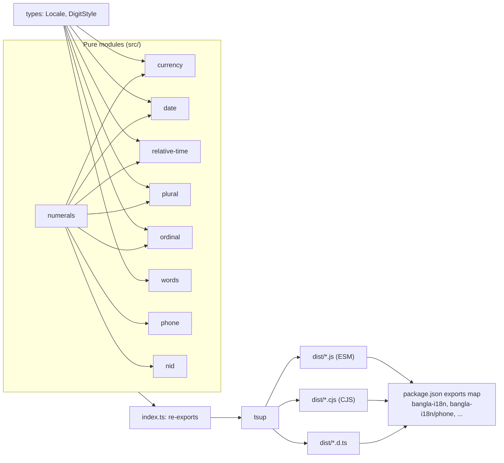

<!-- topics: typescript,i18n,bangla,bengali,bangladesh,currency-formatting,localization,npm-package,zero-dependency -->
# bangla-i18n

Zero-dependency TypeScript toolkit for products that speak both Bangla and English: numerals, Taka formatting, dates, relative time, plurals, ordinals, number-to-words, Bangladeshi phone numbers and NID checks.

[](https://github.com/AkibUllah/bangla-i18n-toolkit/actions/workflows/ci.yml)


[](LICENSE)

## Why this exists

Every fintech, e-commerce and POS product I have shipped in Bangladesh needed the same handful of helpers: show ৳1,23,456.78 with lakh/crore grouping, print "এক হাজার দুইশত পঞ্চাশ টাকা মাত্র" on an invoice, accept a phone number typed as `০১৭১২-৩৪৫৬৭৮` or `+880 1712 345678`, and validate a 10/13/17-digit NID before calling the verification API. `Intl` gets some of this right in some runtimes and nothing right in others, and each team ended up re-implementing the rest in a `utils/bn.ts`. This package is that file, done once, typed, tested and tree-shakeable.

## Features

- Bangla digit conversion in both directions, plus a forgiving `parseLocalizedNumber` for user input (`৳ ১,২৩,৪৫৬.৭৮` -> `123456.78`).
- BDT formatting with Indian grouping (`৳1,23,456.78`), symbol/code/word variants, Bangla digits, and an exact `formatBDTFromPaisa` for integer minor units (`number` or `bigint`, no floating point).
- Compact amounts for dashboards: `৳1.25 crore`, `৳২.৫ লাখ`.
- Date formatting with Day.js-style tokens, Bangla month and weekday names, and Bangla parts of day (সকাল, দুপুর, বিকাল, রাত) in place of AM/PM.
- Relative time in both languages: `৫ মিনিট আগে`, `in 3 days`, `গতকাল`.
- CLDR-correct plural categories for `en` and `bn`, plus Bangla classifiers (`৩টি পণ্য`, `৫ জন গ্রাহক`).
- Ordinals in suffix or word style: `22nd`, `২য়`, `১২তম`, `তৃতীয়`.
- Number and amount to words up to 99,999 crore in English (lakh/crore or million/billion) and Bangla, cheque-ready (`... টাকা পঞ্চাশ পয়সা মাত্র`).
- BD mobile numbers: normalise any notation, validate against BTRC prefixes (013-019), identify the operator, format as E.164/international/local, mask for receipts.
- NID: detect 10/13/17-digit formats, structural validation with birth-year bounds, 13 -> 17 conversion, masking.
- Fully typed, strict TypeScript, no runtime dependencies, ESM + CJS, per-module subpath exports, ~7.6 kB gzipped for the whole thing.

## Architecture



Design decisions:

- Every function is pure and takes an options object with a `locale` and `digits` so callers can mix Bangla names with Western digits (common in receipts) without a second API.
- Money never passes through `Number` arithmetic once it is a string: grouping and decimal placement are done on decimal strings, and `formatBDTFromPaisa` works on `bigint` end to end.
- No `Intl` reliance. Output is identical in Node, browsers, Cloudflare Workers and React Native, which is where `Intl.NumberFormat('bn-BD')` tends to disagree with itself.
- Subpath exports (`bangla-i18n/phone`) plus `sideEffects: false` let bundlers ship only the module you use.
- Validation functions return `null`/`false` for user input and throw `RangeError` only for programmer errors (invalid dates, out-of-range indexes), so UI code does not need try/catch.

## Tech Stack

| Area | Choice |
| --- | --- |
| Language | TypeScript 5.4, `strict` + `noUncheckedIndexedAccess` + `exactOptionalPropertyTypes` |
| Build | tsup 8 (ESM + CJS + `.d.ts`, source maps) |
| Tests | Vitest 1.x, 75 tests |
| Lint | ESLint 8 + typescript-eslint 7 |
| Runtime deps | none |
| Target | Node 18+, modern browsers (ES2020) |

## Quick Start

Local development:

```bash
git clone git@github.com:AkibUllah/bangla-i18n-toolkit.git
cd bangla-i18n-toolkit
npm ci
npm test          # vitest
npm run lint      # eslint + tsc --noEmit
npm run build     # dist/ with ESM, CJS and types
npm run size      # gzip size table of the bundles
```

Docker (runs lint, tests and build in a clean Node 18 image, then prints a sample):

```bash
docker build -t bangla-i18n .
docker run --rm bangla-i18n
```

Installing in a project once published:

```bash
npm install bangla-i18n
```

## Usage

```ts
import {
  formatBDT, formatBDTFromPaisa, formatCompactBDT,
  toBanglaDigits, toEnglishDigits, parseLocalizedNumber,
  formatDate, formatRelativeTime,
  pluralize, withClassifier, ordinal,
  numberToWords, amountToWords,
  normalizeBDPhone, formatBDPhone, getBDOperator, maskBDPhone,
  isValidNID, getNIDFormat, maskNID,
} from 'bangla-i18n';
```

### Numerals

```ts
toBanglaDigits(2024);                    // '২০২৪'
toBanglaDigits('Order #1023');           // 'Order #১০২৩'
toEnglishDigits('৳১,২৩,৪৫৬');            // '৳1,23,456'
parseLocalizedNumber('৳ ১,২৩,৪৫৬.৭৮');   // 123456.78
parseLocalizedNumber('Tk 500');          // 500
```

### Currency

```ts
formatBDT(123456.78);                               // '৳1,23,456.78'
formatBDT(1500, { locale: 'bn' });                  // '৳১,৫০০'
formatBDT(1500, { symbol: 'code' });                // 'BDT 1,500'
formatBDT(1500, { symbol: 'word', locale: 'bn' });  // '১,৫০০ টাকা'
formatBDT(1500, { minimumFractionDigits: 2 });      // '৳1,500.00'
formatBDT(-500);                                    // '-৳500'

formatBDTFromPaisa(12345678);                       // '৳1,23,456.78'  (exact, integer in)
formatBDTFromPaisa(-5000n);                         // '-৳50.00'

formatCompactBDT(12_500_000);                       // '৳1.25 crore'
formatCompactBDT(250_000, { locale: 'bn' });        // '৳২.৫ লাখ'
formatNumber(1234567.891);                          // '12,34,567.89'
formatNumber(1234567, { grouping: 'western' });     // '1,234,567'
```

### Dates and relative time

```ts
const d = new Date(2026, 2, 26, 15, 5);

formatDate(d, 'D MMMM YYYY', { locale: 'bn' });      // '২৬ মার্চ ২০২৬'
formatDate(d, 'dddd, h:mm A', { locale: 'bn' });     // 'বৃহস্পতিবার, ৩:০৫ বিকাল'
formatDate(d, 'YYYY-MM-DD HH:mm');                   // '2026-03-26 15:05'
formatDate(d, '[Date:] D MMM', { locale: 'bn', digits: 'en' }); // 'Date: 26 মার্চ'

formatRelativeTime(fiveMinutesAgo, { locale: 'bn' }); // '৫ মিনিট আগে'
formatRelativeTime(inTwoDays, { locale: 'bn' });      // '২ দিন পরে'
formatRelativeTime(yesterday);                        // 'yesterday'
formatRelativeTime(yesterday, { numeric: 'always' }); // '1 day ago'
```

Tokens: `YYYY YY MMMM MMM MM M DD D dddd ddd HH H hh h mm m ss s A a`; literal text goes in `[brackets]`. Pass `now` in `formatRelativeTime` options for deterministic output in tests.

### Plurals, classifiers and ordinals

```ts
pluralize(3, { one: 'order', other: 'orders' });                 // '3 orders'
pluralize(3, { one: 'অর্ডার', other: 'অর্ডার' }, { locale: 'bn' }); // '৩ অর্ডার'
getPluralCategory(0, 'bn');                                      // 'one' (CLDR)

withClassifier(3, 'পণ্য');            // '৩টি পণ্য'
withClassifier(5, 'গ্রাহক', 'জন');    // '৫ জন গ্রাহক'

ordinal(22);                                   // '22nd'
ordinal(3, { style: 'word' });                 // 'third'
ordinal(2, { locale: 'bn' });                  // '২য়'
ordinal(12, { locale: 'bn' });                 // '১২তম'
ordinal(3, { locale: 'bn', style: 'word' });   // 'তৃতীয়'
```

### Number to words

```ts
numberToWords(12_50_000);                          // 'twelve lakh fifty thousand'
numberToWords(1_250_000, { system: 'western' });   // 'one million two hundred fifty thousand'
numberToWords(1250, { locale: 'bn' });             // 'এক হাজার দুইশত পঞ্চাশ'

amountToWords(1250.5);                 // 'one thousand two hundred fifty taka and fifty paisa only'
amountToWords(1250.5, { locale: 'bn' }); // 'এক হাজার দুইশত পঞ্চাশ টাকা পঞ্চাশ পয়সা মাত্র'
```

### Phone numbers

```ts
normalizeBDPhone('+880 1712-345678');   // '01712345678'
normalizeBDPhone('০১৭১২৩৪৫৬৭৮');        // '01712345678'
normalizeBDPhone('01212345678');        // null (012 is not allocated)

isValidBDPhone('01812345678');          // true
getBDOperator('01812345678');           // { prefix: '018', name: 'Robi', code: 'ROBI' }

formatBDPhone('01712345678');                   // '+880 1712-345678'
formatBDPhone('01712345678', 'e164');           // '+8801712345678'
formatBDPhone('+8801712345678', 'local');       // '01712-345678'
maskBDPhone('01712345678');                     // '017****5678'
```

### NID

```ts
getNIDFormat('1234567890');            // 'smart-10'
getNIDFormat('19901234567890123');     // 'legacy-17'
isValidNID('99911234567890123');       // false (birth year 9991)
isValidNID('1234567890', { allowedFormats: ['smart-10'] }); // true
toNID17('1234567890123', 1990);        // '19901234567890123'
maskNID('1234567890');                 // '******7890'
```

NID checks are structural only. The Election Commission does not publish a check digit, so real verification still has to go through their service; this library stops obviously wrong input before you pay for that call.

### Subpath imports

```ts
import { formatBDPhone } from 'bangla-i18n/phone';
import { formatBDT } from 'bangla-i18n/currency';
```

Available: `numerals`, `currency`, `date`, `relative-time`, `plural`, `ordinal`, `words`, `phone`, `nid`.

### Bundle size

Measured with `npm run size` (gzip):

| Entry | gzip |
| --- | --- |
| `index.js` (everything) | 7.6 kB |
| `currency.js` | 1.8 kB |
| `date.js` | 1.8 kB |
| `words.js` | 1.9 kB |
| `phone.js` | 1.0 kB |
| `nid.js` | 0.9 kB |

## Project Structure

```
bangla-i18n-toolkit/
├── src/
│   ├── index.ts          # public re-exports
│   ├── types.ts          # Locale, DigitStyle
│   ├── numerals.ts       # ০-৯ <-> 0-9, parseLocalizedNumber
│   ├── currency.ts       # formatBDT, formatBDTFromPaisa, compact
│   ├── date.ts           # formatDate, month/weekday names, day periods
│   ├── relative-time.ts  # formatRelativeTime
│   ├── plural.ts         # CLDR plural rules, classifiers
│   ├── ordinal.ts        # 1st / ১ম / তৃতীয়
│   ├── words.ts          # numberToWords, amountToWords
│   ├── phone.ts          # BD mobile numbers
│   └── nid.ts            # NID formats and validation
├── tests/                # one vitest file per module + API surface test
├── scripts/size.mjs      # gzip size report
├── tsup.config.ts
├── vitest.config.ts
├── Dockerfile
└── .github/workflows/ci.yml
```

## Testing

```bash
npm test
```

75 tests across nine files cover: digit conversion round-trips and parsing edge cases; Indian/western grouping, fraction bounds, negative zero and paisa-exact formatting; every date token, Bangla day periods and literal escapes; relative-time thresholds and auto words in both locales; CLDR plural categories; English teen-ordinal exceptions and Bangla suffixes; all irregular Bangla number words that appear in the 0-99 table, lakh/crore composition and cheque amounts; every BTRC operator prefix and each accepted phone notation; all three NID lengths with birth-year bounds.

## Roadmap

- Bangla calendar (বঙ্গাব্দ) conversion with the 2019 Bangladesh revision.
- `Intl.NumberFormat`-compatible `formatToParts` output for custom rendering.
- Locale packs so `hi`/`ur` numerals and grouping can reuse the same formatters.
- A small React hook package (`useLocale`) that wires `digits`/`locale` through context.
- Property-based tests for the parse/format round trip.

## License

MIT, see [LICENSE](LICENSE).
